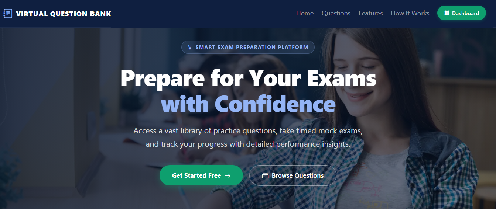
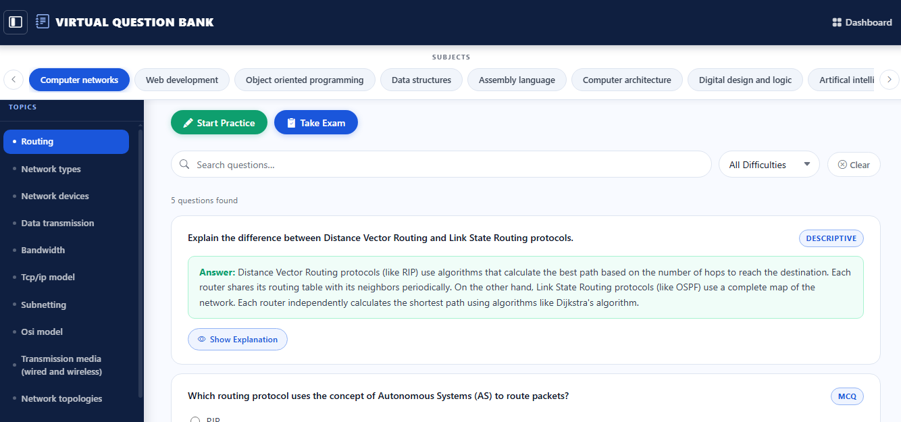
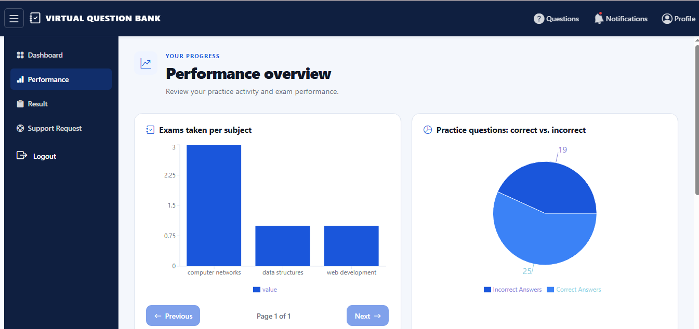
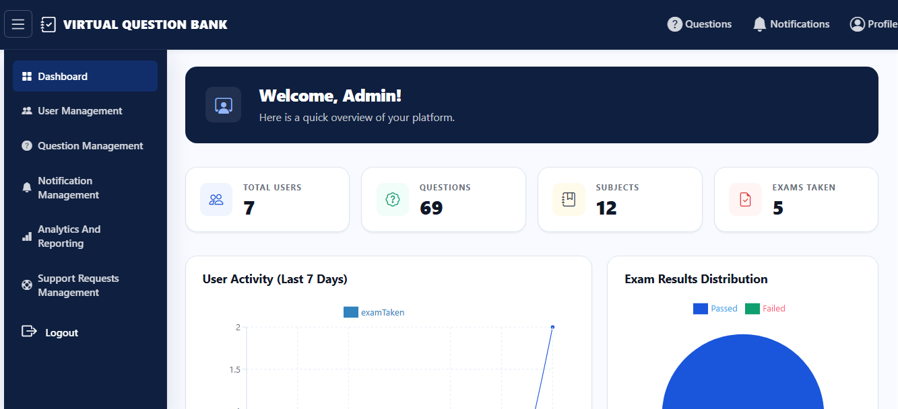
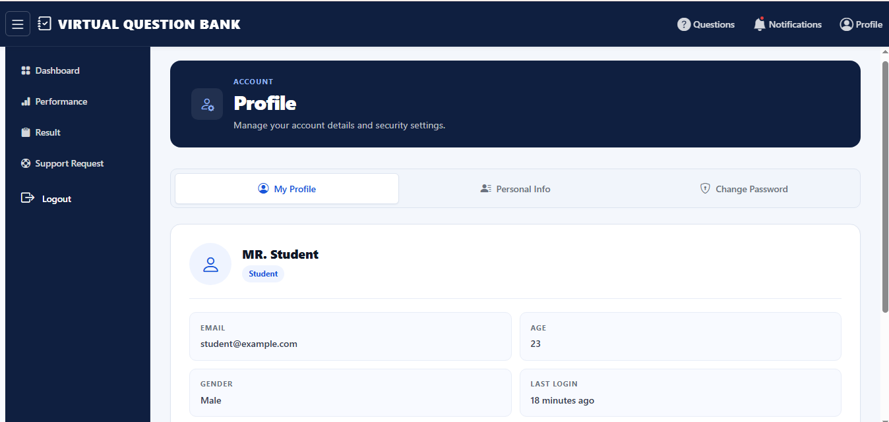
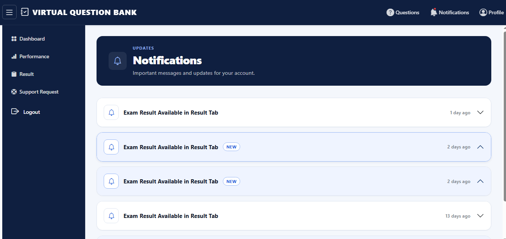
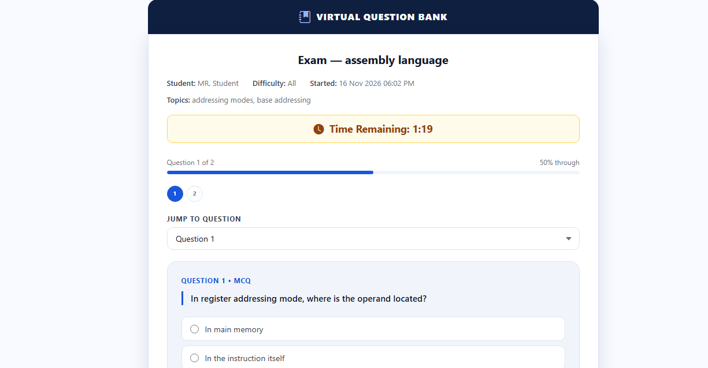

# 🎓 Virtual Question Bank Frontend

<div align="center">

A modern Next.js frontend for a full-stack question bank platform where students can practice, take exams, track performance, and manage support requests, while admins handle users, questions, notifications, and reports.


</div>

---

## Overview

This frontend powers the student and admin experience of the Virtual Question Bank application. It includes:

- Authentication pages for login, registration, password reset, and password confirmation
- Student dashboard, performance tracking, result viewing, notifications, and profile management
- Admin dashboard with analytics, user management, question management, support requests, and notifications
- Subject/topic-based question browsing and practice flow
- Exam workflow and result details

---

## Features

### Student Experience

- Secure login and registration flow
- Password reset request and confirmation pages
- Profile update and password change functionality
- Browse questions by subject and topic
- Practice questions and complete exams
- Performance analytics and result history
- Notification center and support request submission

### Admin Experience

- Dashboard overview with analytics cards and summary panels
- User management and account controls
- Question and subject management
- Notification creation and management
- Support request management and resolution workflow
- Reporting and analytics exports

---

## Screenshots

> Screenshots are stored in `public/screenshots` and referenced from this README using the correct project-relative paths.

### Home Page



### Question Page



### Student Dashboard



### Admin Dashboard



### Profile Page



### Notifications Page



### Exam Page



---

## Tech Stack

- Framework: [Next.js](https://nextjs.org/)
- UI Library: [React](https://react.dev/)
- Styling: Bootstrap + custom CSS modules
- Data Fetching: React Query
- PDF Export: jsPDF + html2canvas
- Charts: Recharts
- Authentication: JWT-based session handling via backend API

---

## Project Structure

```bash
frontend/
├── public/
│   ├── screenshots/
│   └── hero.jpg
├── src/
│   ├── app/
│   ├── components/
│   ├── hooks/
│   └── utils/
├── .env.local
├── jsconfig.json
├── next.config.mjs
├── package.json
├── README.md
└── ...
```

---

## Getting Started

### 1. Install dependencies

```bash
npm install
```

### 2. Configure environment variables

Create a `.env.local` file in the `frontend` folder and add the backend API URL:

```bash
NEXT_PUBLIC_BACKEND_URL=http://localhost:5000
```

> Make sure the backend server is running before starting the frontend.

### 3. Run the development server

```bash
npm run dev
```

Then open:

```bash
http://localhost:3000
```

### 4. Production build

```bash
npm run build
npm run start
```

---

## Test Accounts

Use the following credentials for local testing when the backend is running.

### Student

- Email: `student@example.com`
- Password: `student@123`

### Admin

- Email: `admin@example.com`
- Password: `admin@123`

> Credentials may vary depending on your seeded database or local backend setup.

---

## Backend Repository

This frontend connects to the backend API for authentication, questions, exams, notifications, and admin actions.

- Backend repo: [Virtual Question Bank Backend](https://github.com/wareesha-Jannat/virtual-question-bank-backend)

---

## Live Demo

- Frontend: [Virtual Question Bank Frontend](https://virtual-question-bank-frontend.vercel.app)

---

## Credits

- Question icons provided by [Flaticon](https://www.flaticon.com/free-icons/question)
- Built as part of the Virtual Question Bank full-stack project
